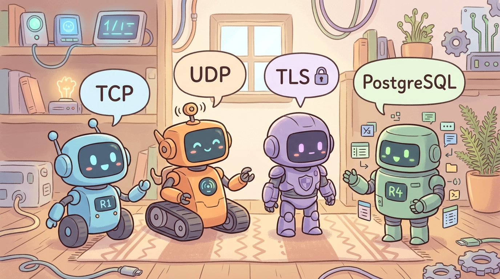

**Greet** is a lightweight Go library to test greet / ping / handshake process in TCP, UDP and other popular protocols based on them.

## Goals
- Fast: The library only performs handshake without entering full session
- Secure: The process ends before authentication / authorization step
- Lightweight: The library constructs raw command from scratch and does not depend on third-party service clients
- Tracing: The library outputs helpful errors from connection init to handshake

## Installation

### Library

```bash
go get github.com/crystade/greet@latest
```

### CLI

```bash
go install github.com/crystade/greet/cmd/greet@latest
```

## Documentation

- **[Core](./docs/Core.md)** — library API, supported protocols, options, error handling, timing model, and how to add new protocols.
- **[CLI](./docs/CLI.md)** — command-line usage, flags, output formats (human-readable & JSON), scripting examples.
- **[JSON API](./docs/JSON%20API.md)** — JSON request/response model, protocol-specific data schemas, and integration guide.

## License

This project is licensed under the MIT License - see the [LICENSE](LICENSE) file for details.
